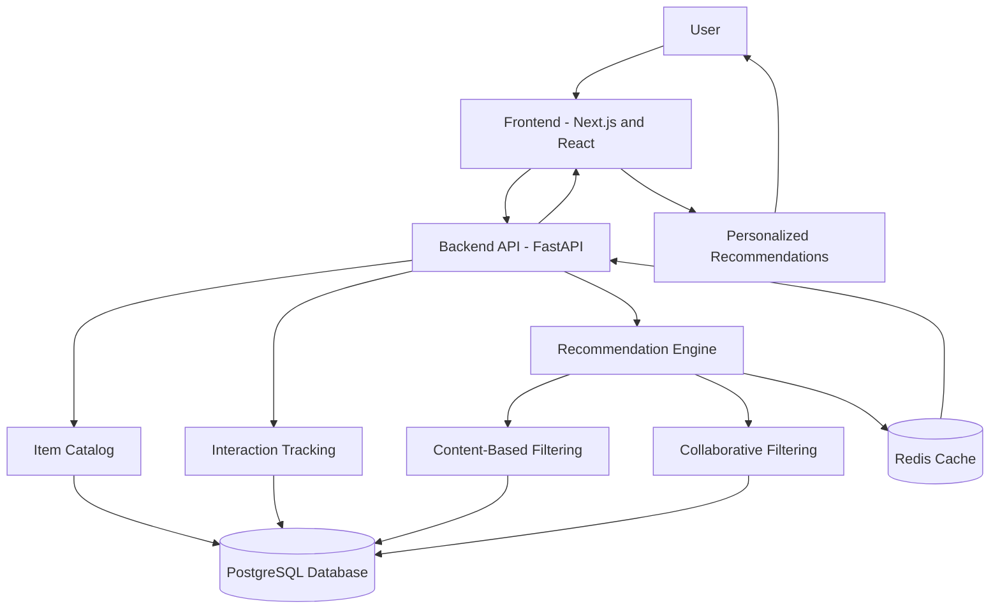

# AI Recommendation Engine – System Architecture

## 1. Project Overview

The AI Recommendation Engine is a system designed to recommend relevant products, courses, or articles to users based on their interests, preferences, and interaction history.

## 2. System Components

### Frontend
Built with Next.js and React. It provides the user interface for browsing items and viewing personalized recommendations.

### Backend API
Built with Python and FastAPI. It handles application requests and connects the frontend to the recommendation services and database.

### Item Catalog
Manages the products, courses, or articles available for recommendation.

### Interaction Tracking
Records user activities such as item views and clicks.

### Recommendation Engine
Generates personalized suggestions using content similarity and recommendation algorithms.

### Filtering Service
Supports content-based filtering and collaborative filtering.

### Database
PostgreSQL stores application data, while pgvector supports vector-based similarity search.

### Caching Service
Redis stores frequently requested recommendation results to improve retrieval speed.

### Evaluation Module
Measures recommendation performance and helps identify areas for improvement.

## 3. System Workflow

1. A user accesses the application through the frontend.
2. The frontend sends requests to the backend API.
3. The backend retrieves relevant user and item information.
4. User interactions are recorded.
5. The recommendation engine processes available information.
6. Relevant recommendations are generated.
7. Results are returned to the frontend for display.

## 4. Technology Stack

- Frontend: Next.js and React
- Backend: Python and FastAPI
- Machine Learning: scikit-learn, pandas and sentence-transformers
- Database: PostgreSQL and pgvector
- Caching: Redis

## 5. Development Approach

The project will be developed in stages, beginning with backend setup and item management, followed by interaction tracking, recommendation algorithms, frontend integration, and system evaluation.

## 6. System Architecture Diagram

